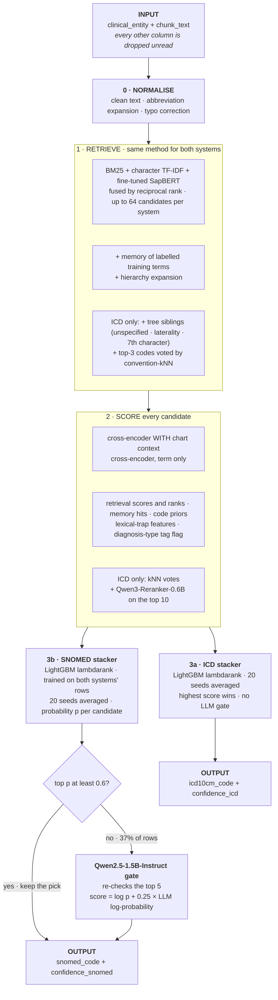

# TermMap-X+: clinical term → ICD-10-CM + SNOMED CT

TermMap-X+ maps a clinical term extracted from a chart, read together with the chunk of text it came from, to **one ICD-10-CM code and one SNOMED CT concept**.

- **CSV in, CSV out, one command.**
- **Fully local:** every model runs on your machine, with no API calls, no keys, and no data leaving the machine.
- **Deterministic** for a fixed input.

- Web app: we also built a working browser version: termmap-x.vercel.app/lab.html. Map one term or upload a whole CSV.

Our laptops have no GPU, so the site must be connected to a GPU runtime to run the full engine. Without it, only a few built-in examples work.
Please give us a heads-up before uploading a large file so we can connect the runtime first.

| | ICD-10-CM | SNOMED CT |
|---|---|---|
| **Final model, held-out replay** (components chosen on 60% of chunks, scored on the other 40%) | **68.7%** | **68.9%** |
| Final model, out-of-fold (470 / 541 rows, 5 chunk-grouped folds) | 74.9% | 67.5% |
| Blind internal test, scored once, **v1 build** (243 / 275 diagnosis rows) | 72.4% | 70.5% |

**Expect about 70% on new data.** The blind test was scored once on the v1 build (X + ICD tree/siblings + lexical traps). The components added after that were selected on pooled dev+test, so the final model has no untouched test score; the held-out replay is its most conservative estimate. See [Results](#5-results).

Contents:
1. [How it works](#1-how-it-works-the-pipeline)
2. [Setup](#2-setup)
3. [Environment variables](#3-environment-variables)
4. [Running the engine](#4-running-the-engine)
5. [Results](#5-results)
6. [Reproducing the results](#6-reproducing-the-results)
7. [What we tried](#7-what-we-tried)
8. [External resources](#8-external-resources)
9. [Repository layout](#9-repository-layout)
10. [Security and data](#10-security-and-data)


---

## 1. How it works (the pipeline)

The engine extends **Approach X**, a retrieve → score → decide cascade. Each step narrows the problem:
- **Retrieval** finds a small candidate set that almost always contains the right code.
- **Scoring** describes every candidate with many signals.
- **A learned stacker** combines those signals to pick one code per system.
- **A small LLM** is consulted only for low-confidence SNOMED picks.



**What each stage achieves** (out-of-fold, ICD / SNOMED):

| stage | job | measured |
|---|---|---|
| **1 · Retrieve** | recall: get the right code into a short list | gold code in the pool: **94.3% / 89.6%**; top-1 of the fusion alone: 41.5% / 48.2% |
| **2 · Score** | describe every candidate with many signals | best single scorer (context cross-encoder): **52.3% / 55.8%** |
| **3 · Decide** | combine the signals into one pick per system | final model: **74.9% / 67.5%** out-of-fold; **68.7% / 68.9%** held-out replay |
| Qwen2.5 gate | second opinion on unsure SNOMED picks only | called on 37% of SNOMED rows; adds about 2 points |
| Output | one valid code per system + a confidence | always a code from the supplied dictionaries |

**Why this shape:**
- **Lexical and dense retrieval together.** BM25 and TF-IDF catch exact and rare wording; SapBERT catches paraphrases and abbreviations.
- **Cross-encoders read the term next to each candidate**, in its chart context. This is how *MS* resolves to multiple sclerosis or mitral stenosis.
- **The stacker learns the coders' conventions** from labelled data, such as when "unspecified" is correct and when to be specific.
- **An LLM is used only where the stacker is unsure.** That's 37% of SNOMED rows; the LLM never runs on ICD.

**Each component and its code:**

| stage | component | code |
|---|---|---|
| normalise + retrieve | char TF-IDF, BM25, fine-tuned SapBERT, reciprocal-rank fusion, training-term memory, hierarchy expansion | `termmap/normalize.py`, `termmap/retrieval.py`, `termmap/dense.py` |
| retrieve (ICD) | tree siblings; convention-kNN codes | `termmap_plus/pools.py`, `termmap_plus/v2b_knn.py` |
| score | cross-encoders (context query `system : term ‖ window`, and term only) | `termmap/reranker.py`, `round3/sf.py` |
| score | X's features (`tag_compat` replaced by `cand_is_diag_tag`), lexical traps, kNN votes | `termmap/features.py`, `termmap_plus/features_plus.py` |
| score (ICD) | Qwen3-Reranker-0.6B, P("yes") on the top 10 | `termmap_plus/v2_qwen3.py` |
| decide | LightGBM stackers, 20 seeds | `termmap/stack.py`, `artifacts/plus/sf/stackers_none_dtag.pkl` |
| decide (SNOMED) | Qwen2.5-1.5B gate, one forward pass, letter log-probabilities, no sampling | `termmap/llm.py`, `termmap_plus/predict_sf.py` |
| entry point | input guard → pipeline → CSV | `predict.py` → `termmap_plus/predict_sf.py` |

All settings (features, the 20 seeds, the diagnosis-type tag list, the memory) are frozen in [`artifacts/plus/sf/sf_recipe.json`](artifacts/plus/sf/sf_recipe.json).

**The input has no `subconcept` column, and nothing reads one at prediction time.**
- The input guard keeps only the term, `chunk_text` and `chunk_id`.
- The cross-encoder query has no subconcept field.
- The one feature X derived from it is replaced by a flag computed from the candidate alone.

---

## 2. Setup

**Requirements:**
- Python 3.11
- about 8 GB of free disk space
- internet once, for `pip`, our trained weights (Hugging Face) and the two Qwen models
- an NVIDIA GPU is optional but much faster (tested on a 4 GB RTX 2050)

```bash
git clone <this repo> termmap-xplus                      # code + data (weights come from Hugging Face)
cd termmap-xplus
python -m venv .venv
source .venv/bin/activate                                # Windows: .venv\Scripts\activate
pip install -r requirements.txt                          # pinned versions; torch 2.14.1 with CUDA 12.6
python setup_model.py                                    # downloads + checks our weights, downloads the 2 Qwen models
```

`setup_model.py` does three things:
1. It downloads our 3.0 GB of trained weights from **[huggingface.co/redolance/termmap-xplus-weights](https://huggingface.co/redolance/termmap-xplus-weights)** into the same paths the code reads (`models/`, `data/processed/`).
2. It checks all 16 trained weight files against [`artifacts/WEIGHTS_MANIFEST.json`](artifacts/WEIGHTS_MANIFEST.json).
3. It downloads Qwen2.5-1.5B-Instruct and Qwen3-Reranker-0.6B from their official pages at pinned revisions, with no account or token.

After that, nothing else is downloaded.

**Troubleshooting:**
- **"missing or modified" / placeholders:** the weight download was interrupted. Run `python setup_model.py` again; it resumes.
- **Windows path limit:** clone into a short folder, for example `C:\work\termmap-xplus`. Some model-cache paths inside the repository are about 120 characters long, and Windows refuses paths over 260 characters unless long paths are enabled.
- **No GPU:** set `TERMMAP_DEVICE=cpu`. Everything still runs, but it is much slower.

---

## 3. Environment variables

None are required. No API keys are used anywhere.

Optional settings go in a `.env` file at the repository root: copy [`.env.example`](.env.example). `.env` is git-ignored, so never commit it.

| variable | default | effect |
|---|---|---|
| `TERMMAP_DEVICE` | `auto` | `auto` (GPU if available), `cuda` or `cpu` |
| `TERMMAP_USE_LLM` | `1` | `0` skips the Qwen2.5 SNOMED gate (same as `--no-llm`): faster, about 2 points lower on SNOMED |
| `TERMMAP_SEED` | `13` | the fixed seed of every sampled step |
| `HF_HOME` | `./models/hf_cache` | where the Qwen2.5 model cache lives |

---

## 4. Running the engine

**One command, CSV in → CSV out:**

```bash
python predict.py --input <evaluation_file.csv> --output predictions.csv
```

`make predict INPUT=<evaluation_file.csv> OUTPUT=predictions.csv` does the same. It runs end to end with no manual steps.

**Input:** a CSV (or XLSX) with one row per term.

| column | required | meaning |
|---|---|---|
| `clinical_entity` (or `entity`) | yes | the extracted term, verbatim |
| `chunk_text` | strongly recommended | the chart text around the term; used to disambiguate (e.g. *MS*, *RA*) |
| `chunk_id` | optional | echoed to the output |

Any other column (e.g. `display`, `subconcept`, `coding_system`, gold codes) is dropped before anything runs. `make test` checks that the output is byte-identical with or without such columns.

```csv
clinical_entity,chunk_text
htn,"pmh: htn, hld, dm2. bp 150/90 today, continue lisinopril."
MS,"echo: rheumatic mitral valve with moderate ms, mean gradient 8 mmhg."
chronickidney disease stag 3,"assessment: chronickidney disease stag 3, egfr 45."
```

**Output:** one row per input row.

| column | meaning |
|---|---|
| `chunk_id` and/or `chunk_text` | echoed from the input |
| `clinical_entity` | echoed from the input |
| `icd10cm_code` | one ICD-10-CM code, always valid in the supplied ICD-10-CM table |
| `snomed_code` | one SNOMED CT concept id, always valid in the supplied SNOMED CT table |
| `confidence_icd`, `confidence_snomed` | the stacker's probability for each pick (well calibrated: ECE 0.05 / 0.04) |
| `confidence` | the lower of the two |

**Using the confidence (abstention):** keeping only rows with `confidence_icd ≥ 0.76` auto-codes 60% of ICD terms at 90% precision. `confidence_snomed ≥ 0.75` auto-codes 50% of SNOMED terms at 90% precision. The rest can go to human review. See [Results](#5-results).

**Speed:** about 4 s per *new* term on a 4 GB laptop GPU; terms already seen are cached.

---

## 5. Results

**At a glance** (the model in this repository):

| measure | ICD-10-CM | SNOMED CT |
|---|---|---|
| **Exact match, held-out replay** (most conservative) | **68.7%** | **68.9%** |
| Exact match, blind test (**v1 build**, scored once) | 72.4% [66.5, 77.7] | 70.5% [64.9, 75.6] |
| **Long tail: unseen-code accuracy**, blind test (v1 build) | 61.5% [48.0, 73.5] (n=52) | **63.2%** [54.9, 70.9] (n=136) |
| **Long tail: unseen-code accuracy**, out-of-fold | 63.4% [53.6, 72.1] (n=101) | **59.7%** [53.9, 65.3] (n=278) |
| **Partial credit: right 3-character category** | **81.5%** blind (v1) · 81.7% out-of-fold | – |
| **Abstention: auto-code coverage at 90% precision** | **60%** of terms (`confidence_icd ≥ 0.76`) | **50%** of terms (`confidence_snomed ≥ 0.75`) |
| **LLM gate: share of rows sent to Qwen2.5** | 0% (no gate for ICD) | **37%** (202 / 541 out-of-fold) |
| **Run command** | `python predict.py --input <evaluation_file.csv> --output predictions.csv` | |
| **Speed** | **3.9 s per new term** on a 4 GB RTX 2050 (retrieval p50 0.9 s / p95 2.0 s); repeated terms cached | |
| **Size** | peak **RAM 3.6 GB** · peak **VRAM 3.1 GB** · **disk 7.3 GB** (repo 0.2 GB + our weights 3.0 GB + Qwen models 4.1 GB) | |
| **Determinism** | two fresh runs on the same input are byte-identical | |

Details for each row follow.

Unless stated otherwise, all numbers are top-1 exact match on **diagnosis rows**, with 95% Wilson intervals.

**Headline:**
- The **blind internal test** was scored once, while the split was unseen: 243 ICD and 275 SNOMED rows, grouped by chunk. That run used the **v1 build** (X + ICD tree/siblings + lexical traps, 5-seed stacker).
- Everything added after v1 (Qwen3-Reranker, convention kNN, 20 seeds, the subconcept-free path) was selected on pooled dev+test, so the test split is no longer blind for the final model.
- The **out-of-fold** numbers pool dev and test (470 / 541 rows) and use 5 chunk-grouped folds with the 20-seed stacker.

| | ICD-10-CM | SNOMED CT |
|---|---|---|
| Exact match: blind test (v1 build) | 72.4% [66.5, 77.7] | 70.5% [64.9, 75.6] |
| Exact match: final model, out-of-fold | 74.9% | 67.5% |
| **Held-out replay of our component selection** (chosen on 60% of chunks, scored on 40%) | **68.7%** | **68.9%** |
| Re-drawn folds (3 new chunk-grouped 5-fold splits, stacker refit, no gate) | 71.3–73.0% | 64.7–65.8% |

The out-of-fold rows were also used to choose components, so the held-out replay is our most conservative estimate. **Expect about 70% on new data.** With 243–541 rows per system, differences under about 3 points are within noise; most components added after v1 gain 1–2 points each and should be read as small, not certain.

**Long tail (codes never seen in training).** A code is *unseen* when it is not the gold code of any diagnosis row in the training split.

| unseen-code accuracy | ICD-10-CM | SNOMED CT |
|---|---|---|
| Blind test (v1 build) | 61.5% [48.0, 73.5] (n=52) | **63.2%** [54.9, 70.9] (n=136) |
| Out-of-fold: X+ v2 reference → final model | 59.4% → 63.4% [53.6, 72.1] (n=101) | 59.0% → **59.7%** [53.9, 65.3] (n=278) |

Half of all SNOMED test terms have a gold code that never occurs in training, and the engine still gets about 60% of them right. For SNOMED, the convention-kNN vote alone would get 31.8% [28.0, 35.8] overall.

**Partial credit: ICD 3-character category.** When the exact ICD code is wrong, it is often the right category with the wrong specificity.

| | exact code | right 3-character category |
|---|---|---|
| Blind test (v1 build) | 72.4% | **81.5%** [76.1, 85.9] |
| Out-of-fold | 74.9% | **81.7%** [78.0, 84.9] |

**Abstention: auto-code coverage at 90% precision.** These use the engine's own `confidence_*` columns, out-of-fold.

| | rows auto-coded at ≥ 90% precision | threshold | calibration error (ECE, 10 bins) |
|---|---|---|---|
| ICD-10-CM | **60%** | `confidence_icd ≥ 0.76` | 0.05 |
| SNOMED CT | **50%** | `confidence_snomed ≥ 0.75` | 0.04 |

Coverage when 80% of rows are auto-coded: ICD 83.8% accurate, SNOMED 78.3% accurate (calibrated, cross-fitted).

**LLM gate:** **37%** of SNOMED rows go to the Qwen2.5 gate: 202 of 541 out-of-fold rows have top probability < 0.6. On a run over the internal test input, 150 of 760 terms (20%) were routed. The gate adds about 2 points to SNOMED. It never runs on ICD.

**CPU-only fallback:** without the Qwen3-Reranker score, ICD is 73.8% out-of-fold, compared with 74.9% with it.

**Run command** (reproduces predictions from an input file):

```bash
python predict.py --input <evaluation_file.csv> --output predictions.csv
```

**Speed and size:** measured on a laptop with an RTX 2050 (4 GB) and 12 CPU threads.

| | value |
|---|---|
| Latency, new terms (nothing cached) | **3.9 s per term**: 760 terms in 49 min, including both cross-encoders, Qwen3 and the gate |
| Retrieval alone | p50 0.9 s, p95 2.0 s per term |
| Repeated terms | cached; much faster |
| Peak GPU memory (VRAM) | **3.1 GB** |
| Peak RAM | **3.6 GB** (peak working set of the engine process, measured on a 40-term run) |
| Disk | **7.3 GB**: repository 0.2 GB + 3.0 GB trained weights (Hugging Face) + Qwen2.5 2.9 GB + Qwen3 1.2 GB |
| Model calls per term | 2 cross-encoder passes per candidate; Qwen3 on the top 10 (ICD); Qwen2.5 once for ~37% of SNOMED terms |

At chart volume, a server GPU would cut latency several-fold. The CPU-only fallback avoids the Qwen3 call.

---

## 6. Reproducing the results

**a. Score the submitted evaluation predictions** (blind test, v1 build → 72.4% / 70.5%):

```bash
python score.py --pred submission/evaluation_predictions.csv
```

Expected output:

```
ICD10CM      exact      72.4% [66.5, 77.7] (n=243)
             unseen     61.5% [48.0, 73.5] (n=52)
             category   81.5% [76.1, 85.9] (n=243)
SNOMEDCT_US  exact      70.5% [64.9, 75.6] (n=275)
             unseen     63.2% [54.9, 70.9] (n=136)
```

[`submission/evaluation_predictions.csv`](submission/evaluation_predictions.csv) holds the predictions on the evaluation set. No separate evaluation file was provided, so this is our internal **blind test split**: 289 diagnosis terms, never used for training or selection before it was scored once. The columns are `chunk_text, clinical_entity, icd10cm_code, snomed_code`.
- 518 of the 578 codes come from the blind run of the v1 build (`source_* = blind_v1`), scored once before the later components were added.
- The other 60 have no gold label for that system, so the blind run did not predict them. The final engine fills them in for completeness (`final_model_no_gold`), and they are not scored.

**b. Run the final engine on the same input:**

```bash
python predict.py --input data/splits/test_input.csv --output out.csv
python score.py --pred out.csv
```

`out.csv` matches [`submission/reference_predictions.csv`](submission/reference_predictions.csv). A fresh GPU run matched 989/989 SNOMED codes and 986/989 ICD codes; the 3 differences are near-ties that flip with GPU half-precision rounding. Two fresh runs on the same input are byte-identical ([`submission/determinism.json`](submission/determinism.json)).

> **The score of step b (~98% / ~91%) is not an accuracy.** The final engine uses all labelled rows, including this split, as memory and stacker training data, so it has seen these answers. The valid numbers are the blind v1 numbers from step a and the held-out replay in [Results](#5-results).

**c. Out-of-fold and ablation numbers** come from the development ledgers in [`results/`](results/): [`ledger_sf.md`](results/ledger_sf.md) for the final build and [`X_PLUS_SUMMARY.md`](results/X_PLUS_SUMMARY.md) for the history. Every change was kept only if it passed a pre-declared rule:
- accuracy goes up;
- fixed − broken ≥ √(fixed + broken);
- unseen-code accuracy drops by no more than 1.5 points.

---

## 7. What we tried

Change in top-1 accuracy (points) when each idea was added, measured on the evaluation protocol of the time: dev split for the first rows, pooled out-of-fold afterwards. "–" means not applicable or not measured.

| idea | ICD | SNOMED | outcome |
|---|---|---|---|
| ICD tree siblings in the pool (unspecified / laterality / 7th character) | +1.3 | +1.5 | **kept** |
| Lexical-trap features (extra / missing words, head noun, abbreviation) | 0.0 | +1.5 | **kept** |
| 20-seed stacker average (removes ±1 pt seed noise) | +0.2 | +0.8 | **kept** |
| Qwen3-Reranker-0.6B zero-shot score | +1.1 | +0.4 | **kept for ICD**; not significant for SNOMED |
| Convention kNN (votes + top-3 voted codes) | +1.5 | −0.6 | **kept for ICD** |
| Qwen2.5 SNOMED gate (switching it off) | 0.0 | −2.0 | **kept for SNOMED** |
| Subconcept-free cross-encoder query + diagnosis-tag flag | −0.2 | −0.2 | **kept** (needed: the evaluation file has no subconcept) |
| SNOMED semantic-tag filter on candidates | – | −0.2 | dropped |
| Clinical checklist veto (laterality / acuity / status) | −1.3 | −1.2 | dropped |
| ICD tree-evidence features / specificity-policy features | −0.5 / −0.2 | −0.8 / +0.3 | dropped |
| Larger SNOMED LLM (Qwen3-8B, kNN examples) | 0.0 | +0.9 | dropped (fixed/broken not significant) |
| Smarter gate, negation alignment, convention priors, ICD release priors | −0.6 to 0.0 | −0.4 to 0.0 | dropped |
| CE-2 reranker trained on our data: replace X's cross-encoder | −1.5 | −0.9 | dropped |
| CE-2 reranker trained on our data: add as features | −1.7 | +0.9 | passed for SNOMED; **not in this build** |
| Qwen LoRA fine-tune as reranker | – | – | abandoned (training diverged) |
| Lane E features (abbreviation context, CDC index, cleaned text, truncation) | – | – | built; not evaluated before the deadline |

**What still fails, and what we'd do next:**
1. **SNOMED concepts never seen in training** (about half of SNOMED terms) are the largest error source.
2. **Specificity near-ties in ICD**, where the right category is chosen but not the right code: 81.5% category vs 72.4% exact.
3. **Abbreviations with thin context.**

Next steps: a stronger reranker trained on more data, the official SNOMED→ICD map as a joint-consistency signal, and abstention routing to human review.

---

## 8. External resources

| resource | use | licence |
|---|---|---|
| `cambridgeltl/SapBERT-from-PubMedBERT-fulltext` | dense retriever, fine-tuned here (`models/sapbert-ft/`) | Apache-2.0 |
| `microsoft/BiomedNLP-BiomedBERT-base-uncased-abstract-fulltext` | base of both cross-encoders, fine-tuned here (`models/cross-ctx/`, `models/cross-noctx/`) | MIT |
| `Qwen/Qwen3-Reranker-0.6B` @ `e61197ed45024b0ed8a2d74b80b4d909f1255473` | ICD zero-shot scorer, used as is | Apache-2.0 |
| `Qwen/Qwen2.5-1.5B-Instruct` @ `989aa7980e4cf806f80c7fef2b1adb7bc71aa306` | SNOMED low-confidence gate, used as is | Apache-2.0 |
| CDC/NCHS ICD-10-CM FY2026 order file + Alphabetic Index (`data/external/cdc/`) | ICD hierarchy, billable flags, index aliases | public domain |
| Hackathon ICD-10-CM and SNOMED CT code tables (`data/raw/`) | the legal answer space | as supplied |
| LightGBM, scikit-learn, rapidfuzz, PyTorch, transformers | stacker, features, fuzzy matching, inference | MIT / BSD / Apache-2.0 |

Neither the UMLS nor the official SNOMED→ICD-10-CM map is used.

---

## 9. Repository layout

| path | contents |
|---|---|
| `predict.py` | **entry point:** CSV in → CSV out |
| `setup_model.py` | one-time setup: download + verify trained weights, download the two Qwen models |
| `score.py` | score a predictions CSV against the internal test split |
| `Makefile` | `make install / setup / predict / demo / test` |
| `termmap/` | Approach X engine: normalisation, retrieval, dense encoder, cross-encoders, features, stacker, LLM gate |
| `termmap_plus/` | X+ additions: ICD siblings, convention kNN, lexical traps, Qwen3 scorer, subconcept-free predict path (`predict_sf.py`) |
| `round3/` | subconcept-free cross-encoder query and diagnosis-tag flag (`sf.py`) |
| `models/sapbert-ft/`, `models/cross-ctx/`, `models/cross-noctx/` | trained models (downloaded from Hugging Face by `setup_model.py`) |
| `models/stack_settings.pkl` | stacker temperature |
| `artifacts/plus/sf/` | frozen recipe (`sf_recipe.json`) and the 20-seed stackers (`stackers_none_dtag.pkl`) |
| `artifacts/WEIGHTS_MANIFEST.json` | sha256 of every trained weight file |
| `data/raw/` | hackathon training CSV, ICD-10-CM and SNOMED CT code tables |
| `data/splits/` | train / dev / test split (seed 13, grouped by chunk) |
| `data/processed/` | concept and alias tables, abbreviations, typo vocabulary, dense + lexical alias indexes (Hugging Face) |
| `data/external/cdc/` | CDC FY2026 ICD-10-CM files |
| `shared/` | ICD tree, scope |
| `configs/plus.yaml` | X+ flags |
| `tests/` | input-guard test (`make test`) |
| `submission/evaluation_predictions.csv` | predictions on the evaluation set (blind test split) |
| `submission/reference_predictions.csv` | final engine's output on `data/splits/test_input.csv` (install check) |
| `submission/determinism.json` | two fresh runs, byte-identical |
| `results/` | development ledgers |

---

## 10. Security and data

- **No API keys, tokens or credentials** are in this repository, and none are needed. The Qwen downloads need no account.
- `.env` is git-ignored; [`.env.example`](.env.example) lists the optional settings and contains no secrets.
- **The hackathon data is proprietary.** `data/raw/`, `data/splits/` and the trained weights derived from them are included only because this repository is **private**. Do not make it public or send the data to any third-party service.
- Use of the SNOMED CT table is subject to your SNOMED licence.
